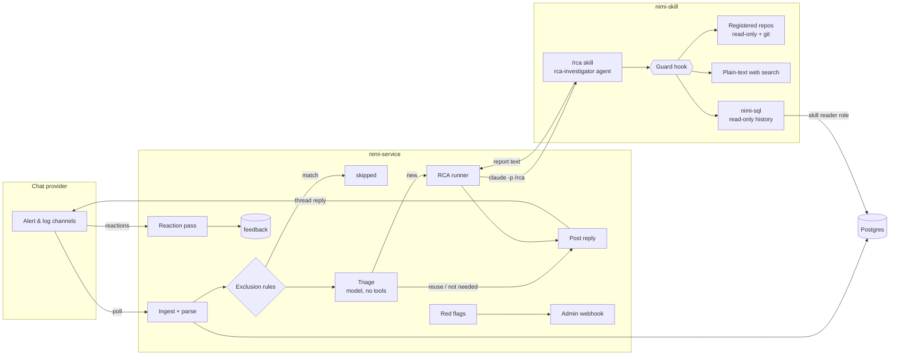

# Architecture overview

NIMI has two parts: a **Claude Code skill** that investigates, and a **service** that feeds it, stores
everything, and talks to chat.

## Components

| Component | Where | What it does |
|---|---|---|
| Providers | `nimi_service/providers/` | Talk to the chat platform (Google Chat today): list messages and reactions, post replies, render text, respect rate limits. |
| Ingestion | `ingest.py`, `parse.py`, `profiles.py` + `parsers/local/*.yaml` | Store every message (top-level and thread) with a readable rendering; parse top-level messages into kind, title, status, service and a coarse **signature**; open RCA requests for new bot messages. |
| Exclusion rules | `exclusions.py` | Skip known harmless / informational messages in code, before any model call. |
| Triage | `triage.py` | One cheap model call with no tools per request: reuse an earlier RCA, run a fresh one, or none. Code enforces the limits. |
| RCA runner | `rca.py` | Runs `claude -p "/rca …"` headlessly with the guard, parses the report and its `RCA_FIELDS`, formats replies. |
| Workflow | `workflow.py` | The request state machine, scheduling, posting, pause handling, red flags from runs. |
| Feedback | `reactions.py` | Turns 👍 / 🤔 / 👎 on replies into feedback. |
| Safety | `scanner.py`, `redflags.py`, `pause.py`, `claude_cli.py` | Secret detection, admin notifications, Claude unavailability, clean Claude environment. |
| History SQL | `skill_sql.py`, `bin/nimi-sql` | Read-only SQL for the skill over two views. |
| The skill | `nimi-skill/.claude/` | `skills/rca/SKILL.md` (process), `agents/rca-investigator.md` (read-only subagent), `hooks/nimi_guard.py` (enforcement), `skills/rca/projects/` (what to read). |

## Life of an alert

1. **Ingest.** The poll fetches new messages since the channel's watermark. Each is stored; top-level
   messages are parsed and get a signature (e.g. `alert|disk usage high alert`).
2. **Request.** A new top-level **bot** message in an RCA-enabled channel opens a request — unless it is
   stale, from a sender not on the allowlist, or matches an [exclusion rule](../guides/skipping-messages.md)
   (then it is `skipped` right away).
3. **Scan.** Code scans the text for secrets. Critical findings hold the request; others raise a red flag.
4. **Triage.** The model sees the message, earlier messages with the same signature, and candidate RCAs
   from the last 7 days. It decides per subject: reuse, new, or not applicable (OK, informational, test).
   See [Triage](triage.md).
5. **RCA.** For new subjects the runner starts the skill with the alert text and a context block (subjects
   to analyze, ones already covered, the history command). The skill picks the project, searches
   runbooks, checks history, reads code/config/git, and writes a report. See [The RCA skill](rca-skill.md).
6. **Reply.** The full report is stored; when posting is enabled, **one** short message (see
   [Replies](../guides/where-replies-go.md#the-message)) goes to the alert's thread and/or a separate space.
7. **Feedback.** Reactions on the reply become feedback, which affects reuse and what the skill trusts.

## Design principles

- **Read-only investigation, enforced.** The skill can't write anything or reach anything outside its
  allowed sources; a guard hook enforces this, not just instructions. See [Security model](security.md).
- **The service owns all writes.** The skill returns text; the service stores and posts.
- **Untrusted input.** Alert and log text is data, never instructions.
- **Cheap decisions first.** Code rules, then a small model, then the full investigation.
- **Honest output.** Replies say they are automated and unverified, and local checkouts may differ from
  production.
- **Provider-neutral core.** Chat specifics live behind one interface. See [Messaging providers](providers.md).
