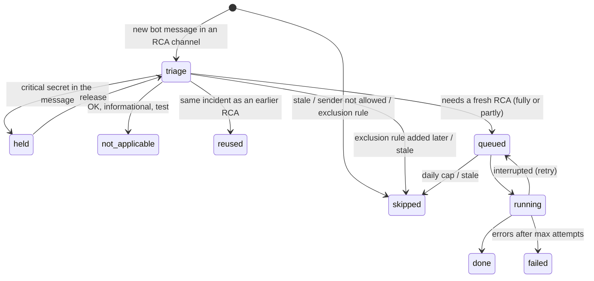

# Operating the service

Commands run from `nimi-service/` as `.venv/bin/python -m nimi_service <command>`. The full list is in
the [CLI reference](../reference/cli.md).

## The poll loop

`run` repeats every `NIMI_POLL_SECONDS` (default 60):

1. **Recover stuck runs**: requests left `running` longer than `NIMI_RCA_TIMEOUT_SECONDS` + 60s go back to
   the queue, or to `failed` after `max_attempts` (2).
2. **Ingest** new messages from every channel (first poll of a channel backfills).
3. **Schedule**:
    - post replies that finished but were never posted (outbox sweep);
    - if Claude is [paused](claude-availability.md), stop here;
    - skip requests older than `NIMI_STALE_HOURS`;
    - triage waiting requests (up to 20 per cycle);
    - start queued RCAs, up to `NIMI_MAX_PARALLEL` at once and `NIMI_MAX_PER_DAY` per UTC day.
4. **Reactions**: sync 👍 / 🤔 / 👎 on replies posted in the last `NIMI_REACTION_DAYS`.
5. **Red flags**: retry notifications that failed to send.

A failing cycle raises a red flag and the loop carries on.

## Request lifecycle



`reused`, `not_applicable`, `done`, `skipped` and `failed` are final. Every skip has a `skip_reason`.

## Watching it

```bash
.venv/bin/python -m nimi_service status       # channels, message counts, request states, active pause
.venv/bin/python -m nimi_service red-flags    # things an admin should look at
.venv/bin/python -m nimi_service exclude      # exclusion rules and their hit counts
```

Logs go to stderr (INFO level): each poll's counts, triage decisions, RCA runs with cost and duration.

## Restarts and downtime

Progress lives in Postgres, so after a restart (even a long one) the service continues where it stopped:

- **Messages:** each channel's watermark makes the first poll fetch everything posted while it was down
  (with `overlap_seconds` of overlap so nothing is missed).
- **One age rule:** alerts older than `NIMI_STALE_HOURS` (default 6) when NIMI can process them get no RCA —
  whether they arrived during downtime, waited in the queue across a shutdown, or waited out a usage-limit
  pause (`skip_reason`: "stale: alert older than …").
- **Interrupted runs** go back to the queue (subject to the age rule).
- **Missed replies:** an RCA or reuse decision that finished but was never posted is posted by the outbox
  sweep on the next poll, if the alert is still within `NIMI_STALE_HOURS`.

## Running it permanently

NIMI has no packaged service unit yet. A systemd user unit like this works:

```ini
# ~/.config/systemd/user/nimi.service
[Unit]
Description=NIMI RCA service
After=network-online.target

[Service]
WorkingDirectory=%h/nimi/nimi-service
ExecStart=%h/nimi/nimi-service/.venv/bin/python -m nimi_service run
Restart=on-failure
RestartSec=30

[Install]
WantedBy=default.target
```

```bash
systemctl --user daemon-reload && systemctl --user enable --now nimi
journalctl --user -u nimi -f
```

## Maintenance tasks

| Task | Command |
|---|---|
| Pull older history for a channel | `backfill <channel> --days N` (stored as backfill: no RCAs; safe to re-run) |
| Rebuild parses/signatures after changing `parse.py` or a [platform profile](platform-profiles.md) | Check with `parse-test`, then `reparse` (bump `RULES_VERSION` in `parse.py` for code changes; profile changes are versioned automatically). Also moves RCA requests to their message's new signature, so earlier RCAs stay reusable, and warns about exclusion rules whose signature no longer exists. |
| Clear a Claude pause now | `resume` |
| Send a held request to triage anyway | `release <request_id>` |
| Keep project copies current | `"sync"` in the registry, or a cron job ([Adding a project](adding-a-project.md#use-a-dedicated-copy-and-keep-it-current)) |
| Back up the database | `pg_dump -h 127.0.0.1 -U nimi_service nimi > nimi-$(date +%F).sql` |
| Apply new migrations after pulling | `db upgrade` (back up first) |
